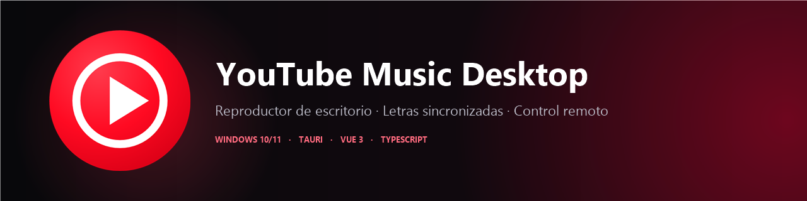
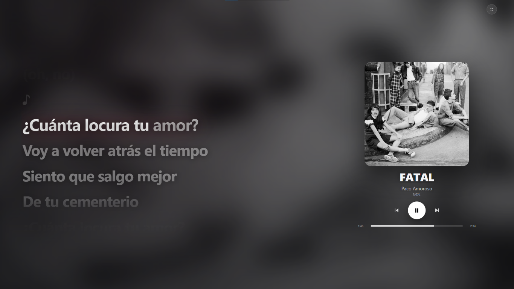
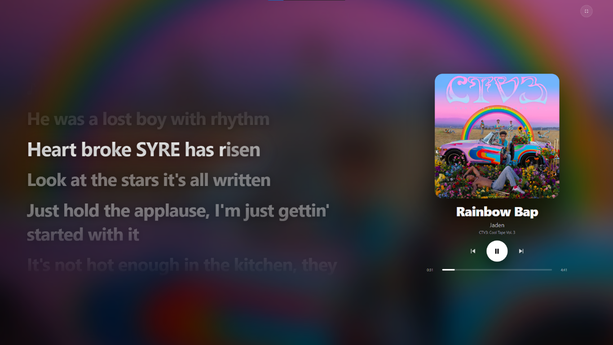
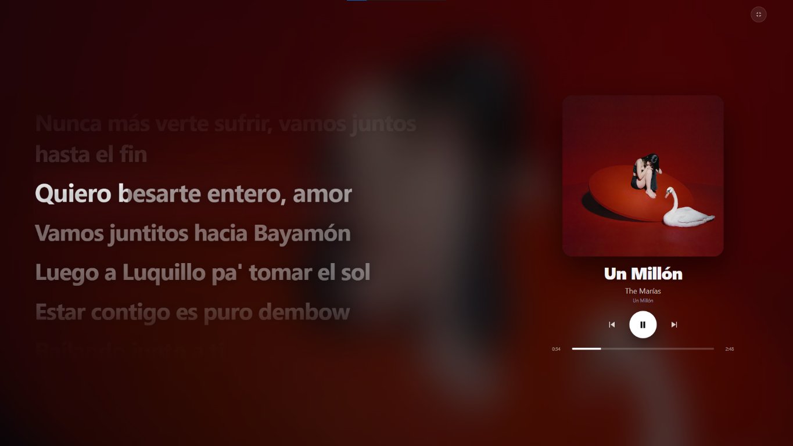

<p align="center">
  
</p>

<h1 align="center">YouTube Music Desktop</h1>

<p align="center">
  <strong>YouTube Music en tu escritorio. Letras sincronizadas, pantalla grande y control remoto.</strong>
</p>

<p align="center">
  <a href="https://github.com/Jesusghdev/ytmusic-app/releases/latest">
    
  </a>
  
  
  
  
  <a href="LICENSE">
    
  </a>
</p>

<p align="center">
  <a href="https://github.com/Jesusghdev/ytmusic-app/releases/latest">
    
  </a>
</p>

<p align="center">
  <a href="https://github.com/Jesusghdev/ytmusic-app/issues">Reportar un problema</a>
  &nbsp;·&nbsp;
  <a href="https://github.com/Jesusghdev/ytmusic-app/releases">Todas las versiones</a>
</p>

---

## Una experiencia de escritorio para YouTube Music

**YouTube Music Desktop** combina la web oficial de YouTube Music con una interfaz nativa hecha en Tauri. Todo ocurre en una sola ventana: buscas y eliges tu música en YouTube Music y la aplicación añade la capa que falta para disfrutarla en el escritorio.

- **Tu cuenta, tu biblioteca.** Inicia sesión con Google una vez y usa búsquedas, playlists, álbumes y recomendaciones.
- **Letras sincronizadas.** Línea actual resaltada, salto al hacer clic y una ventana de contexto en el modo inmersivo.
- **Pantalla grande.** Una vista tipo karaoke con la carátula difuminada, controles y letra.
- **Control remoto.** Escanea un código QR y controla la reproducción desde el celular en la misma red.
- **Hecho para Windows.** Barra de título propia, atajos de teclado y sesión persistente.

## Descargar

[**Última versión**](https://github.com/Jesusghdev/ytmusic-app/releases/latest) · Windows 10/11 x64

| Opción | Archivo | Cuándo usarla |
| --- | --- | --- |
| **Instalador** | `*-setup.exe` | Recomendado. Instala accesos directos y desinstalador. |
| **Portable** | `*-portable-windows-x64.zip` | Sin instalación: descomprime y ejecuta. |

No necesitas instalar Rust ni Node.js. El instalador incluye la aplicación; solo requiere Microsoft Edge WebView2, incluido en Windows 11 y disponible para Windows 10.

> [!NOTE]
> La aplicación no está firmada digitalmente. Windows puede mostrar SmartScreen; pulsa **Más información → Ejecutar de todas formas**. El código es abierto y puedes compilarlo tú mismo.

## Capturas

### Pantalla grande

La vista de pantalla grande muestra la letra sincronizada junto con la carátula,
el fondo adaptado a la canción y los controles de reproducción.

<p align="center">
  
</p>

<p align="center">
  
</p>

<p align="center">
  
</p>

## Cómo funciona

La aplicación integra la web oficial de YouTube Music en WebView2 y se comunica con ella mediante un puente local para leer el estado del reproductor, sincronizar la letra y enviar comandos. Las letras se consultan en **LRCLIB** (sincronizadas) y **Lyrics.ovh** (texto), con reintentos automáticos.

**Stack:** Tauri 2 · Rust · Vue 3 · TypeScript · Vite · WebView2.

## Privacidad y seguridad

- No contiene contraseñas, cookies ni claves de API en el repositorio.
- El inicio de sesión con Google se realiza en la web oficial dentro de WebView2; la sesión se guarda localmente en el equipo.
- El control remoto usa un token aleatorio persistente incluido únicamente en
  el enlace del código QR; úsalo solo en redes de confianza. Si compartes el
  enlace, cualquier persona que lo tenga podrá consultar el estado y controlar
  la reproducción mientras la aplicación esté abierta.
- Las búsquedas de letras envían título, artista, álbum y duración a LRCLIB y Lyrics.ovh; no se envía información de la cuenta.
- La aplicación no crea un historial de reproducción propio.

## Limitaciones

- Proyecto **no oficial**, no afiliado a Google ni a YouTube. YouTube Music y su logo son marcas de Google.
- No todas las canciones tienen letra en las fuentes abiertas.
- El control remoto funciona en la red local; no está pensado para exponerse a Internet.
- Sin actualizaciones automáticas: descarga la nueva versión desde Releases.

## Desarrollo

<details>
<summary>Compilar desde el código</summary>

Requiere Node.js 20+, Rust estable y WebView2.

```bash
npm install
npm run tauri dev
```

Para generar el instalador:

```bash
npm run tauri build
```

</details>

## Créditos

- [LRCLIB](https://lrclib.net/) — letras sincronizadas de la comunidad.
- [Lyrics.ovh](https://lyrics.ovh/) — letras de respaldo.
- [Tauri](https://tauri.app/), [Vue](https://vuejs.org/) y [Vite](https://vite.dev/).

## Licencia

MIT. Consulta [LICENSE](LICENSE). Las marcas de YouTube Music pertenecen a Google; esta licencia no otorga derechos sobre ellas.
